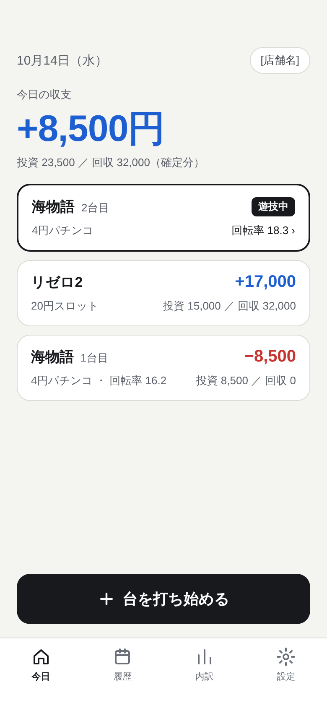
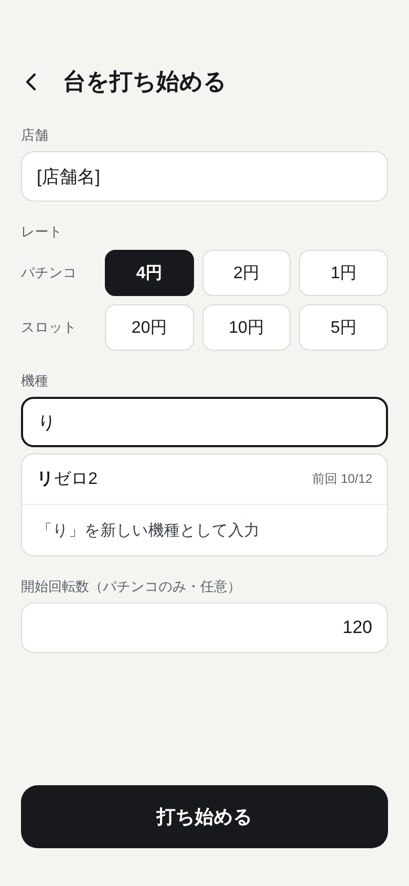
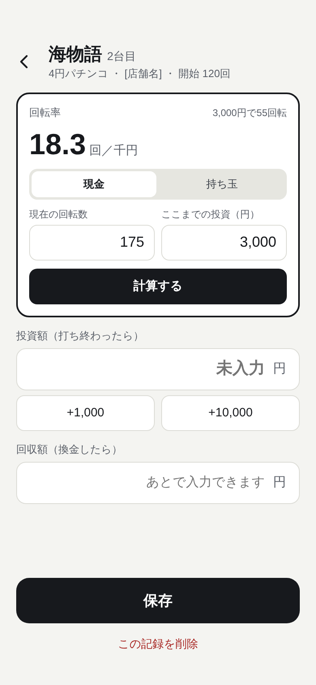
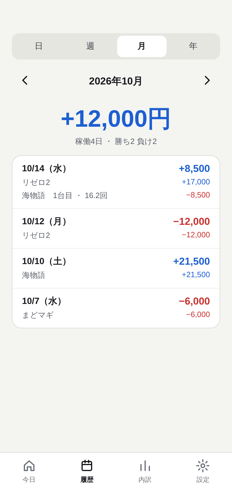
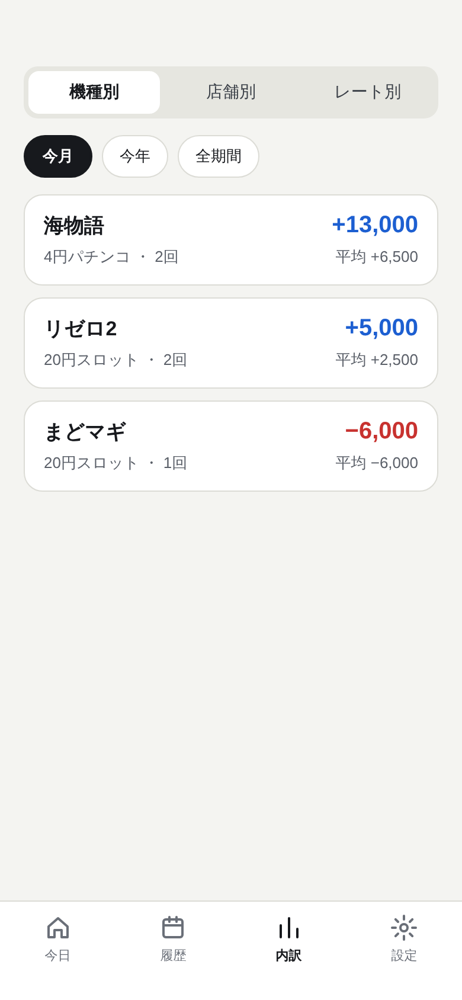

# 画面案（第一弾）

仕様は [SPEC.md](../../SPEC.md) を参照。各画面は同名の `.html` をブラウザで開くと、タップで画面間を移動できる。

| 画面 | 画像 |
|---|---|
| ① 今日（ホーム） |  |
| ② 台を打ち始める |  |
| ③ 台の記録（回転率・投資・回収） |  |
| ④ 履歴（日・週・月・年） |  |
| ⑤ 内訳（機種別・店舗別・レート別） |  |

- 画面内の機種名・金額は表示例。`[店舗名]` は実際の店舗名が入る場所。
- 設定画面（書き出し・読み込み・全データ削除）は画面案なし。
